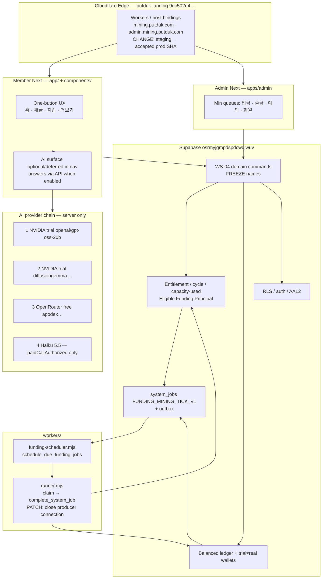

# PUTDUK MINING — FINAL Owner-Desired Launch Architecture

Status: **CANONICAL FOR “원하는 대로 작동 + 완전 단순화 출시”**
Date: `2026-10-21`
Workspace: `C:\Dev\putduk-mining`
Baseline tip: `2d7e903c712726f4540cdbe860d9410935023f4e` · Platform: **NOT_LAUNCH_READY** · PRODUCT COMPLETE routes = **0** · develop tip full E2E FAIL (run `39253488361`) · public hosts still **STAGING**

Authorized targets only: GitHub `goldeget/putduk-mining` · Supabase `osrmyjgmpdspdcwqjwuv` · Cloudflare `putduk-landing` `9dc502d4ef06b3b5374591de6e6933ca`.

---

## Document authority / SSOT merge

This file is the **single owner-facing final architecture** for:

1. Mining that actually accrues under the **Eligible Funding Principal** model.
2. Member AI that answers via the approved provider cascade (with honest enable gates).
3. Fully simplified one-button UX.
4. Agent-automated delivery of all non-gated work.

| Document | Role |
| --- | --- |
| **This file** | **SSOT for the desired end-state + Phase A–E roadmap + go/no-go for “원하는 대로 + 단순화 출시”.** |
| `LAUNCH-SIMPLIFICATION-PATCH-ARCHITECTURE.md` | Upstream UX reduction, AI automation contract, Phase 0–4 surface freeze. **Merged here as Phase A–B + agent contract; do not diverge.** |
| `ECONOMY-V1-USER-APPROVAL-2026-10-03.md` | **Money lock:** Eligible Funding Principal, Tier bps, 30-day capacity, carry. Never contradict. |
| `MINING-ENTITLEMENT-CYCLE-CONTRACT.md` | Entitlement/cycle/settlement structure; **RUNTIME NOT CONNECTED** remains honest until Phase C exit. |
| `docs/ai/PUTDUK-AI.md` | AI cascade, dispatch switch, `paidCallAuthorized`, production block. |
| `WS-04-DOMAIN-COMMAND-CONTRACT.md` | Frozen public command names — **consume only; never invent aliases.** |
| `GIT-CI-CD-POLICY.md` · `E2E-AGENT-WORKFLOW.md` | Remote/CI/E2E walls. |

**Contradiction resolution**

1. Full V1 PRODUCT COMPLETE matrices vs simplified launch → this file + launch-simplification define the **narrow kept surface** launch bar (owner D5 still required).
2. “사용량” in entitlement docs = **cycle capacity used**, never app/AI usage minutes.
3. Private funded-engine foundation exists locally; **settlement runner / producer connection is incomplete** — do not claim live accrual today.
4. AI chain exists in code; **not live for users** until owner-gated enablement.
5. Staging on `mining.putduk.com` / `admin.mining.putduk.com` is **not** production acceptance.

**Honesty lock:** Current platform is **NOT_LAUNCH_READY**. This architecture is the path to the owner-desired state, not a claim that today works.

---

## 1. 한 장 요약 — 원하는 최종 상태

### Member sees (one mental model)

> **「퍼뜩에서 채굴 버튼만 누르면 수익이 쌓여요.」**

| Member experience | System truth (hidden) |
| --- | --- |
| Large **채굴 시작** / status **채굴 중** | Domain commands + entitlement engine; client never invents amounts |
| 「앱을 닫아도 채굴은 계속돼요」 | Server-time accrual via settlement worker — not browser timers |
| One trusted balance number | Ledger-first projection (trial ≠ real KRW) |
| Optional: AI answers questions | NVIDIA trial → OpenRouter free → Haiku 5.5 last; AI never moves money |
| 출금/입금 as secondary | WS-04 only; USDT = manual deposit → KRW principal, never “USDT 잔액” |

### System does (owner-desired)

1. **Mining works as designed** — reward = f(**Eligible Funding Principal**, Tier rates, eligible elapsed time, cycle **capacity/used**). “사용량” = entitlement capacity used, **not** app opens / AI tokens / Scene frames.
2. **Settlement actually accrues** — schedule → claim `FUNDING_MINING_TICK_V1` → private producer posts earned/used/carry → balanced `MINING_REWARD` journal → outbox. Close the **runtime connection gap**.
3. **AI answers users** when admitted — cascade NVIDIA → OpenRouter free → Haiku 5.5; free failure = honest Korean fallback (static/tools); **paid/production require explicit owner gates**.
4. **UX fully simplified** — bottom nav without 상품/이벤트/AI hubs; home = brand + one line + one CTA.
5. **Agents execute all non-gated work**; humans only at hard authorization walls.

---

## 2. 목표 상태 vs 현재 상태

| Area | Desired (FINAL) | Current (2026-10-21 verification) | Gap class |
| --- | --- | --- | --- |
| **Mining formula** | Eligible Funding Principal × Tier × eligible time; capacity/used caps accrual | Formula/policy + foundation code **PARTIAL** (`domain/mining/*`, entitlement migrations); **not** app/AI usage | Connect + prove |
| **Settlement runner** | Continuous server tick posts rewards while app closed | Private producer foundation local; worker validates envelope then relies on DB `complete_system_job`; **settlement runner incomplete / RUNTIME NOT CONNECTED**; PRODUCT COMPLETE missing | **Critical** |
| **AI answers** | Cascade live for admitted env; paid Haiku owner-gated | Cascade in `lib/ai/provider-chain.ts`; `AI_PROVIDER_DISPATCH_ENABLED` default off; **production hard-blocked**; `paidCallAuthorized: false`; **not live for users** | Owner-gated enable |
| **UX** | One-button IA | Nav still includes 상품; multi-surface IA; launch simplification not shipped | Phase B |
| **Infra** | Prod Workers on accepted release SHA | Public hosts bound to **STAGING** | Human cutover |
| **CI / PRODUCT** | Kept-surface PRODUCT COMPLETE + `ci-full-e2e` green on release SHA | PRODUCT COMPLETE = **0**; tip full E2E **FAIL** `39253488361` (10/12 product gates) | Phase A–E evidence |
| **Platform verdict** | GO under §9 | **NOT_LAUNCH_READY** | Entire roadmap |

---

## 3. 최종 시스템 아키텍처



**Money authority:** Entitlement Engine + ledger inside Postgres. UI/AI/Scene are readers and command preparers only.

---

## 4. 채굴 완작동 아키텍처

### 4.1 What “사용량” means (owner clarification — encode forever)

| Term | Meaning | NOT meaning |
| --- | --- | --- |
| **Eligible Funding Principal** | Remaining qualified KRW principal from real approved deposits / confirmed USDT→KRW / explicit principal correction | Lifetime deposits, BONUS, MINING_REWARD, START, referral, promotions |
| **Capacity** | Max monetary accrual allowed in the current 30-day user cycle (base 1500bps of principal, retention separate/UNCONFIRMED until qualified) | App session length |
| **Used / 사용량** | Earned monetary accrual already accepted against that cycle capacity | App opens, clicks, AI tokens, Scene FPS, online minutes |
| **Speed** | How fast eligible elapsed time fills remaining capacity | Client animation rate |

Rewards accrue from **principal × tier policy × eligible server time**, capped by **capacity − used**. Closing the app must not stop server processing.

### 4.2 Principal formula (policy lock — do not re-invent)

From `ECONOMY-V1-USER-APPROVAL-2026-10-03.md` + entitlement contract:

```text
Eligible Funding Principal  →  Funding Tier (L1–L14) + rates (bps)
Base 30-day Capacity        =  Principal × 1500bps (15.00%)  [+ retention portion separate]
Accrual                     =  f(speed, eligible elapsed segments) ≤ remaining capacity
Posting                     =  whole KRW credit + reward_carry (no float)
Cycle                       =  first principal activation anchor; 30-day [start, end); no reset on deposit/withdraw of rewards
```

Minimum active principal: **KRW 100,000**. Below → `FUNDING_BELOW_MINIMUM` (hold funds OK; no Tier/entitlement activation).

### 4.3 Settlement path — desired vs missing

**Desired tick**

```text
schedule_due_funding_jobs
  → claim_system_jobs(..., p_allow_funding=true)
  → FUNDING_MINING_TICK_V1
  → process / complete_system_job (fenced)
  → private producer: earned receipt + used + carry
  → balanced MINING_REWARD journal + wallet projection + outbox
  → MINING_SETTLEMENT_COMPLETED.v1 consumers (notify only; no second money write)
```

**Current gap (honest — refreshed 2026-10-21 SIMPLIFIED_TRACK)**

| Layer | Real paths | State |
| --- | --- | --- |
| Policy / TS entitlement | `domain/mining/funding-entitlement.ts`, `economy-policy.ts`, `published-policy-reader.ts`, `calculate-settlement.ts` | PARTIAL — calculation authority exists; not product proof alone |
| SQL foundation + producer | `20261006123000`… + later funding cutover/scheduler migrations; legacy `record_mining_settlement` **closed** | Local private producer + `complete_system_job` branch **connected**; see `docs/quality/PHASE-C-SETTLEMENT-CONNECTION.md` |
| Scheduler | `workers/funding-scheduler.mjs` → `public.schedule_due_funding_jobs` | Releases dormant sealed jobs; marker `FUNDING_ENGINE_RUNTIME_NOT_CONNECTED` = not-yet-due, not missing writer |
| Runner | `workers/runner.mjs` — envelope validate then DB-fenced complete | Orchestration **wired**; kept-surface PRODUCT COMPLETE / app-closed E2E still open |
| Design SSOT | `docs/development/design-reviews/DEFAULT-FUNDED-ENGINE-2026-10-06.md` | Historical “disconnected foundation” note; later migrations + worker scheduler superseded the narrow disconnect claim — product/remote gates remain |

**Forbidden:** reopen legacy `record_mining_settlement`; invent public RPC aliases; client-side reward math; second ledger.

### 4.4 Phase C patch steps (agent-automatable)

1. **Inventory connection gaps** against DEFAULT-FUNDED-ENGINE + entitlement §12 findings (`ENT-SETTLEMENT-COMMAND`, `ENT-WORKER-RECOVERY`, `ENT-PENDING-RECEIPT`, etc.) — record exact missing adapter without inventing WS-04 names.
2. **Local-only migrations** (new files only) to connect: activation hook on qualifying principal credit → `prepare_default_funding_job` / due scheduling → runner claim with `p_allow_funding` → fenced `process_default_funding_job` / `complete_system_job` path already contracted.
3. **Worker loop**: ensure `funding-scheduler.mjs` + `runner.mjs` run under project-scoped local stack; prove accrual with app closed (server time advances, balance increases).
4. **Idempotency**: retry same job → same earned receipt; no double used; carry preserved.
5. **Focused E2E / SQL**: principal deposit → Tier → capacity → tick → `MINING_REWARD` projection; never weaken assertions.
6. **Member UX copy**: show one balance + “채굴 중”; never expose engine enums; distinguish retention UNCONFIRMED from spendable reward.

### 4.5 Exit criteria (Phase C)

| # | Criterion | Evidence |
| --- | --- | --- |
| C1 | Accrual uses Eligible Funding Principal + Tier + time only | SQL/unit receipts; no usage meters in formula |
| C2 | Capacity/used enforced; exhaust stops new accrual | Fixture + worker run |
| C3 | App-closed accrual | Worker tick without browser session |
| C4 | Ledger-first balanced post + outbox same tx | Journal + outbox rows |
| C5 | Legacy settlement entrypoint remains closed | Permission denial tests |
| C6 | No WS-04 alias invention | Diff review vs contract |
| C7 | PRODUCT evidence for kept mining/wallet journeys | Focused E2E + matrix subset (not full V1 claim) |

---

## 5. AI 실가동 아키텍처

### 5.1 Cascade (source truth)

Exact order in `lib/ai/provider-models.ts` / `provider-chain.ts`:

| # | Model | Tier | Gate |
| --- | --- | --- | --- |
| 1 | `openai/gpt-oss-20b` | NVIDIA trial | Configured NVIDIA key + admitted dispatch |
| 2 | `google/diffusiongemma-26b-a4b-it` | NVIDIA trial | Pre-answer fallback only |
| 3 | `apodex/apodex-1.1-mini:free` | OpenRouter free | Separate free key; verified zero-price endpoint |
| 4 | `anthropic/claude-haiku-5.5` | OpenRouter paid | **`paidCallAuthorized: true` only** — today route hardcodes `false` |

Fallback before accepted answer text only (network / first-token timeout / 5xx / rate-limit). Cancellation, auth/policy failure, or begun text → no further provider.

### 5.2 Current blocks (not live for users)

| Block | Where | Effect |
| --- | --- | --- |
| Dispatch switch default OFF | `AI_PROVIDER_DISPATCH_ENABLED` via `lib/ai/dispatch-admission.ts` | No provider call; static + owned tools only |
| Production hard block | `appEnv !== "production"` required in admission; `app/api/v1/ai/chat/route.ts` | Even with switch on, **production stays blocked in code** |
| Paid unauthorized | `paidCallAuthorized: false` in route | Haiku never runs; free key missing does **not** jump to paid |
| Launch IA | AI hub hidden/deferred from bottom nav | Answers may exist via deep link later; not peer CTA at simplified launch unless owner changes D6 |

### 5.3 Safe enable checklist (owner-gated)

**Non-production (staging / local admitted) — still needs owner switch:**

1. Confirm targets: `APP_ENV` ≠ `production`.
2. Set server-only keys: `AI_PROVIDER=nvidia`, `AI_API_KEY`, `AI_MODEL_LOW_COST=openai/gpt-oss-20b`; optional `OPENROUTER_FREE_API_KEY`.
3. Set `AI_PROVIDER_DISPATCH_ENABLED=true` (exact string).
4. Verify rate ceilings, streaming cancel, Korean quality smoke, injection tests (`docs/ai/PUTDUK-AI.md` production activation gate).
5. Leave `paidCallAuthorized: false` unless owner explicitly authorizes paid phase + reviewed code change.

**Production enable — separate reviewed phase (HUMAN GATE):**

1. Owner written approval for **production provider dispatch**.
2. Reviewed code change to admit `APP_ENV=production` under the same switch (do not “just flip env”).
3. Retention / endpoint / budget / abuse evidence recorded.
4. Separate owner approval to set `paidCallAuthorized: true` and provision `OPENROUTER_API_KEY` for Haiku — **keys alone never authorize paid**.

### 5.4 What users see when free models fail

| Condition | User-visible behavior |
| --- | --- |
| Switch off / not configured | Deterministic Korean: public facts + own-account tools still work; provider-only questions get honest “지금은 일반 답변을 연결할 수 없어요” style (no fake model answer) |
| NVIDIA/OpenRouter free fail before first token | Next cascade step if allowed; else terminal FAILED + Korean recovery |
| Free key missing | Chain stops — **does not** spend paid |
| Rate limit | `429` — no provider call |
| Paid unauthorized | Never silent charge; Haiku skipped |

AI **never** mutates balances, approvals, mining rewards, or economic rules.

---

## 6. UX 단순화 — one-button IA

Reuse `LAUNCH-SIMPLIFICATION-PATCH-ARCHITECTURE.md` §§2–5. Brief:

| Keep | Hide / Defer |
| --- | --- |
| 홈 · 채굴 · 지갑 · 더보기(thin) | 상품 nav, events hub, AI as peer CTA, promotion trees |
| One CTA: 채굴 시작 / 채굴 중 | Dashboard card walls, ledger tables in member UI |
| One balance number | USDT-as-balance language |

**Primary paths to edit:**
`components/navigation/product-navigation.tsx`, `mobile-navigation.tsx`,
`app/(product)/home/page.tsx`, `mining/page.tsx`, `start/page.tsx`, `wallet/page.tsx`,
`components/product/*`, `components/mining-live/*`.

Korean content gate unchanged (one screen / one idea / short CTAs).

---

## 7. 통합 실행 로드맵 Phase A–E

Default delivery = **agent loops**. Stop only at §8 human gates.

### Phase A — Freeze + surface

| Agent work | Exit |
| --- | --- |
| Verify origin `goldeget/putduk-mining`, Supabase ref, CF account id | `TARGETS_OK` |
| Write kept surface list (`docs/quality/LAUNCH-SIMPLIFIED-SURFACE.md`) | Owner D5 filed or ASSUMED+labeled |
| Freeze money formulas in client; no new domains | Scope file + decision list |
| Record tip SHA / E2E fail baseline | Evidence note |

### Phase B — One-button UX

| Agent work | Exit |
| --- | --- |
| Inventory real nav/home/mining/wallet paths | Touch list |
| Remove/hide 상품; thin 더보기; home = brand + one line + one CTA | First-viewport review checklist |
| Korean copy pass on kept screens | Content gate |
| Focused lint/typecheck/E2E on touched journeys | No new failures |

### Phase C — Mining settlement closure (principal model)

| Agent work | Exit |
| --- | --- |
| Close §4 runner/producer connection gaps locally | C1–C7 |
| Principal × Tier × time accrual with capacity/used | App-closed tick proof |
| Focused mining/wallet PRODUCT subset | Evidence pointers (SIMPLIFIED_TRACK) |

### Phase D — AI cascade enable (owner gates for paid/prod)

| Agent work | Exit |
| --- | --- |
| Staging/local: wire keys + switch docs; smoke free cascade | Non-prod admitted answers OR explicit blocker |
| Prepare production enable PR (code + checklist) — **do not merge/activate** | Owner approval packet |
| Paid Haiku: code path ready, still `paidCallAuthorized: false` until owner | No unpaid surprise |
| Failure UX copy verified | Free fail = honest Korean |

### Phase E — Release cutover + go/no-go

| Agent work | Exit |
| --- | --- |
| Triage tip E2E → narrow fix → kept green | Root-cause fixes only |
| After push approval: PR `ci.yml` ≤20m; release SHA `ci-full-e2e` green | CI evidence |
| CF cutover plan + rollback (prep only until gate) | `CUTOVER-PLAN.md` |
| Fill §9 binary | **GO** or named **NO-GO** |

**Mapping:** Launch-simplification Phase 0–4 ≈ A→B→(partial C evidence)→E infra/release; mining runner closure and AI enable are explicit **C** and **D** here because owner demanded working mining + answering AI.

---

## 8. Human gates only

Agents **STOP** and request explicit owner approval for:

1. `git push` / PR create-update (unknown coupling)
2. Merge to `develop` / `main` / `release/**`
3. Production or staging **deploy** / Worker activate
4. **DNS** / host binding cutover for mining/admin hosts
5. **Remote Supabase** apply/mutation on `osrmyjgmpdspdcwqjwuv`
6. **Production AI dispatch** code/runtime enable
7. **`paidCallAuthorized: true`** / paid OpenRouter key spend
8. Real money / real payouts / paid provider calls
9. GitHub `main` protection / repo visibility changes
10. Legal terms/privacy sign-off
11. Any action with production coupling **UNKNOWN**

**Agents MAY** (in authorized checkout): inventory, UX simplify, local domain/SQL/worker patches, focused tests, evidence packs, cutover *docs*, PR body drafts — commits only when user already authorized in-session.

---

## 9. Go / No-Go — 「원하는 대로 작동 + 단순화 출시」

| # | Must-pass | PASS evidence |
| --- | --- | --- |
| 1 | Targets authorized | remote + Supabase ref + CF id |
| 2 | Mining accrues on principal model | Phase C C1–C7 |
| 3 | Capacity/used (not app usage) | Explicit test + copy audit |
| 4 | One-button UX | Screenshots: home first viewport |
| 5 | Kept-surface PRODUCT COMPLETE | Matrix subset PASS + SHA |
| 6 | Full auth suite on release SHA | `ci-full-e2e` green |
| 7 | PR smoke CI ≤20m | `ci.yml` |
| 8 | Hosts = accepted prod artifact (not staging leftover) | Worker/version IDs |
| 9 | AI: either admitted non-prod answers **or** owner waiver; production only if §5.3 prod gate done | Switch/receipts or waiver |
| 10 | Paid AI: off unless owner authorized | Route/policy evidence |
| 11 | Legal consent approved | Version bound to signup |
| 12 | Money invariants intact | No second ledger; WS-04; trial≠real |
| 13 | No assertion weakening | Triage notes |
| 14 | Coupling classified | UNKNOWN cleared or signed residual |

**GO** = all must-pass true (waivers explicit). Else **NO-GO**.

Current binary: **NO-GO** (NOT_LAUNCH_READY).

---

## 10. 금지 / 불변식

- No second money system; no float; ledger-first; wallet = projection.
- Trial ≠ real; START conversion ceiling KRW 5,000; funding never required for that path.
- Outbox in same transaction as mutation; workers claim via existing `claim_*` contracts.
- Versioned economy/catalog; no market-price API for rewards.
- Client / AI / Scene never determine mining, settlement, or balances.
- **사용량 ≠ app/AI usage**; do not wire usage meters into accrual.
- No legacy `record_mining_settlement` regrant; no invented WS-04 aliases.
- No emoji core icons; no `휴대폰 인증`; no USDT-as-user-balance.
- No assertion weaken / skip / coverage delete for green CI.
- No unpaid surprise AI; production dispatch and paid Haiku are owner gates.
- No Cloudflare D1/KV/R2/Queues/DO/Vectorize/Workers AI duplicating Supabase.
- No push/deploy/remote DB/DNS without explicit approval.
- Do not claim PRODUCT COMPLETE or launch-ready without evidence.

---

## 11. Owner decisions still needed

| ID | Decision | Blocks |
| --- | --- | --- |
| **D5** | Accept **narrowed** PRODUCT COMPLETE surface as launch bar? | Phase A exit / matrix conflict |
| **D6** | Defer member AI + events + products from primary nav? | Phase B; AI may still enable via API without nav peer |
| **AI-PROD** | Authorize **production** provider dispatch (reviewed code + switch)? | Phase D production |
| **AI-PAID** | Authorize `paidCallAuthorized: true` + OpenRouter paid key / Haiku spend? | Cascade step 4 |
| **D1** | Keep staging on public hosts until cutover day? | Phase E sequencing |
| **CUTOVER** | Approve exact SHA Worker/DNS cutover + rollback? | Live traffic |
| **D2 / D3** | Repo private? Protect `main`? | Integrity |
| **D4** | PUT-9 `/login` mockup A/B/C? | Auth visual PRODUCT |
| **D7** | Defer operator assistant PRODUCT vs V1-SCOPE P1? | Admin launch bar |
| **D8** | Legal signer + terms/privacy versions | Signup PRODUCT |
| **D9** | PostHog project/key owner | Analytics min |
| **D10** | Invite-only vs open Korean public | Abuse load |
| **D11** | Auto local commit after focused green? | Agent loop speed |
| **REMOTE-DB** | Approve remote Supabase apply when local C proven? | Production data path |

Until **D5 = YES**, label evidence **SIMPLIFIED_TRACK**, not “full V1 complete”.
Until **AI-PROD / AI-PAID**, do not enable production or paid calls.

---

## 12. How we get there (8 bullets)

1. **Freeze** the simplified kept surface and money locks (Phase A; answer D5).
2. **Ship one-button UX** — home/mining/wallet only as the mental model (Phase B).
3. **Close settlement runner** so principal × Tier × time actually posts while the app is closed (Phase C).
4. **Prove capacity/used** semantics; ban any app-usage interpretation of 사용량.
5. **Enable AI cascade** in non-prod with owner switch; keep paid/prod off until AI-PROD / AI-PAID (Phase D).
6. **Fix tip E2E** by root cause; get kept PRODUCT + release-SHA full suite green (Phase E prep).
7. **Cut over** staging hosts to accepted prod artifact under human DNS/Worker gate.
8. **Binary go/no-go** — only GO when §9 is all true; until then platform stays NOT_LAUNCH_READY.

---

## Upstream pointers

- UX / automation detail: `docs/architecture/LAUNCH-SIMPLIFICATION-PATCH-ARCHITECTURE.md`
- Principal economy: `docs/product/ECONOMY-V1-USER-APPROVAL-2026-10-03.md`
- Cycle/entitlement: `docs/architecture/MINING-ENTITLEMENT-CYCLE-CONTRACT.md`
- Funded engine connection design: `docs/development/design-reviews/DEFAULT-FUNDED-ENGINE-2026-10-06.md`
- AI: `docs/ai/PUTDUK-AI.md`
- Commands: `docs/architecture/WS-04-DOMAIN-COMMAND-CONTRACT.md`
- Release walls: `docs/development/GIT-CI-CD-POLICY.md`

---

*End of FINAL-OWNER-DESIRED-LAUNCH-ARCHITECTURE.md*
