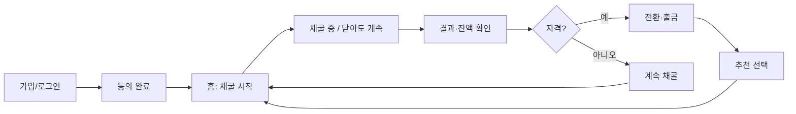
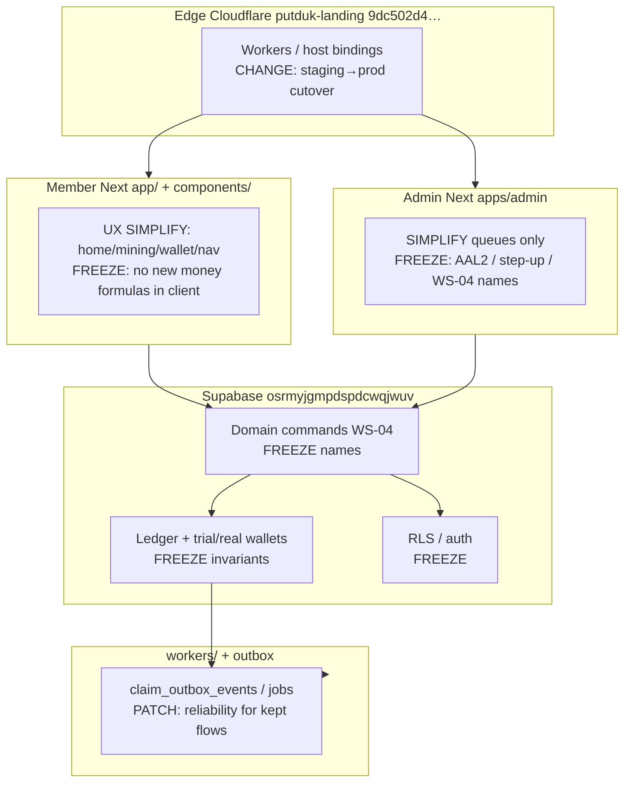

# PUTDUK MINING — Launch Simplification + Patch/Complement Architecture

> **2026-10-21 최종.** 출시 단순화의 결정본은 [`NATIONWIDE-SIMPLE-LAUNCH-ARCHITECTURE.md`](NATIONWIDE-SIMPLE-LAUNCH-ARCHITECTURE.md)다. 판정은 최종 아키텍처 결정됨, 출시 준비는 아니다. 이 파일 본문이 스스로를 출시 SSOT라고 부르거나, §14를 열린 제품 질문으로 두거나, 「버튼만 누르면 수익이 쌓인다」로 입금을 1차 여정에서 빼거나, 하이쿠를 예산 문서 전까지 빼 두는 읽기는 그 결정과 충돌한다. 충돌하면 전국 문서를 따른다. AI는 첫 화면에 없고, 화면을 켤 때의 무료 체인과 하이쿠 한 번은 전국 문서만 따른다. 아래 본문은 자동화 메모로만 남긴다.

Status: **SUPERSEDED FOR LAUNCH SCOPE** by `docs/architecture/NATIONWIDE-SIMPLE-LAUNCH-ARCHITECTURE.md`  
Date: `2026-10-21`  
Workspace: `C:\Dev\putduk-mining`  
Audit baseline: **NOT_LAUNCH_READY** · develop tip `2d7e903c712726f4540cdbe860d9410935023f4e` · PRODUCT COMPLETE routes = **0** · full E2E tip FAIL (run `39253488361`, Authenticated product gates 10/12)

Authorized targets only: GitHub `goldeget/putduk-mining` · Supabase `osrmyjgmpdspdcwqjwuv` · Cloudflare `putduk-landing` `9dc502d4ef06b3b5374591de6e6933ca`.

---

## Document authority / SSOT conflict resolution

| Document | Role for this track |
| --- | --- |
| **This file** | 자동화 메모. 출시 범위의 SSOT가 아니다. 출시 표면·채굴·AI는 `NATIONWIDE-SIMPLE-LAUNCH-ARCHITECTURE.md`만 따른다. |
| `docs/product/V1-SCOPE-PRIORITIES.md` | Upstream P0/P1/P2/P3 **constraints**. Launch day may **hide/defer P1** under the release-scope rule; **no P0 money/safety invariant may be waived**. |
| `docs/architecture/PUTDUK-MINING-MASTER-ARCHITECTURE.md` | Upstream system principles (ledger-first, server authority, outbox). Not launch-day UI surface. |
| `docs/architecture/WS-04-DOMAIN-COMMAND-CONTRACT.md` | Frozen command names. Agents **consume; never invent aliases**. |
| `docs/quality/PRODUCT-COMPLETE-MATRIX.md` · `RELEASE-READINESS-MATRIX.md` · `LAUNCH-STATUS-SUMMARY-*` | Evidence baselines. They currently prove **NOT LAUNCH READY**. This track **narrows** which routes must reach PRODUCT COMPLETE for first public traffic. |
| `docs/development/GIT-CI-CD-POLICY.md` | Hard authorization walls (push/merge/deploy/remote DB/CF). |
| `docs/development/E2E-AGENT-WORKFLOW.md` | Narrow re-run, hung 10분, no assertion weakening. |

**Contradiction call-out (explicit):**

1. **Full V1 PRODUCT COMPLETE for every P0/P1 route** (RELEASE-READINESS / PRODUCT-COMPLETE matrices) vs **this track’s radically simplified public surface**. Resolution: matrices remain truth for “intended complete V1”; **this file is SSOT for what must be PRODUCT COMPLETE before first nationwide public launch**. Deferred surfaces stay behind flags / out of nav / no public claim.
2. **Ops docs vs live Cloudflare** (audit: `mining.putduk.com` / `admin.mining.putduk.com` bound to **STAGING** workers). Resolution: Phase 3 cutover owns live truth; do not treat staging hosts as production acceptance.
3. **Master architecture Cloudflare “new account UNKNOWN”** vs **AGENTS.md authorized `putduk-landing` / `9dc502d4ef06b3b5374591de6e6933ca`**. Resolution for this track: use the **AGENTS.md owner-confirmed Cloudflare identity**; master architecture prose that still says UNKNOWN is stale for account ID only.
4. **Canonical workspace** in older locks (`Desktop\putduk-mining`) vs audit fact **`C:\Dev\putduk-mining`**. Resolution: agents use the **actual checkout that matches `goldeget/putduk-mining`**; record path in every evidence pack.

**Current state is NOT launch-ready.** This architecture is the **minimum safe path** to a radically simplified public launch—not a claim that today is ready.

---

## 1. 목적 / 비목적

### Launch day IS

- Korean public can open the member app and instantly understand: **채굴 버튼만 누르면 된다 → 돈이 쌓인다.**
- Primary mental model (one sentence): **「퍼뜩에서 채굴 버튼만 누르면 수익이 쌓여요.」**
- Core loop works end-to-end with real domain commands, ledger, RLS, server time:
  가입 → 동의 → (START/체험)채굴 시작 → 닫아도 계속됨 → 결과/잔액 확인 → (자격 시) 전환·출금 → 추천은 선택.
- Admin can operate the **minimum queues** for kept money flows (입금 승인, 출금 검토, 예외, 회원 조회).
- Production edge hosts serve the **accepted release SHA**, not staging leftovers.
- Go/no-go is binary evidence (CI, PRODUCT COMPLETE on **kept** journeys only, coupling classified, legal consent approved).

### Launch day IS NOT

- Full intended V1 (events hub, AI partner as primary, PWA push perfection, five-world cinematic depth, promotions trees, Trust Center completeness).
- Claiming PRODUCT COMPLETE = 0 routes is acceptable forever—only until Phase 2 evidence for the **simplified** surface is green.
- A second money system, client-determined mining, USDT-as-user-balance language, or waived ledger/outbox rules.
- Guaranteed income / gambling framing. Honest product rules only (START ceiling KRW 5,000; catalog/versioned settlement).
- Human hand-coding as the default delivery path. **Default = AI agent implementation loops**; humans only at hard authorization gates.

---

## 2. 설계 원칙 — 전국민 UX 간소화

### 2.1 Primary mental model

| Rule | Requirement |
| --- | --- |
| One idea | **채굴 버튼 → 수익 적립** (server-authoritative; UI never invents amounts). |
| First viewport after login | Brand + **one short line** + **ONE** primary 채굴 CTA **or** clear “채굴 중” status. |
| No clutter | No dashboard card walls, multi-metric strips, competing CTAs, feature marketing stacks. |
| Age band | 20s–70s: respectful Korean; no slang; no developer English in UI. |
| Core loop | 시작/계속 채굴 → “앱을 닫아도 채굴은 계속돼요” → 다시 와 결과/잔액 확인. |

### 2.2 Information architecture budget

**Core screens for the launch loop (3–5 max):**

1. **홈** (`/home`) — brand + one line + 채굴 CTA / 채굴 중 상태 + one trusted balance number.
2. **채굴** (`/mining` and/or START entry `/start` as the same mental action, not a second product).
3. **잔액/지갑** (`/wallet`) — one KRW or trial number; actions for 출금/입금 as secondary.
4. **계정/더보기** (`/menu`) — thin: 로그아웃, 약관, 지원, (선택) 추천.
5. **가입/로그인** (`/signup`, `/login`) — public entry only; not part of post-login nav.

### 2.3 Copy rules (Korean content gate)

- One screen, one primary message. One paragraph, one idea. One button, one action.
- Short CTAs: `채굴 시작` · `채굴 중` · `잔액 보기` · `출금 신청`.
- Tone examples (AGENTS.md):  
  - 「앱을 닫아도 채굴은 계속돼요. 다시 접속하면 결과를 확인할 수 있어요.」  
  - 「최대 5,000원까지 출금할 수 있어요. 출금 전 본인 확인이 필요해요.」
- Phone copy = signup availability / already used. **Never** `휴대폰 인증` / SMS verified.
- USDT deposit = **manual deposit**. Withdrawal = against **KRW balance**. Never “USDT 잔액”.
- No long multi-clause Korean; no 4–6 line card essays; no architecture jargon in UI.

### 2.4 Interaction

- Mining button: large touch target; first-class loading / empty / error / success / disabled for **that one action**.
- Respect `prefers-reduced-motion`.
- SVG PUTDUK icons only — **no emoji as core UI icons**.

### 2.5 Money visibility without complexity

- Show **one** trusted balance (trial or real KRW projection from server).
- **No ledger tables** in member UI at launch.
- No USDT-as-balance language; manual USDT deposit is operator-credited KRW under WS-04.

### 2.6 Compliance boundary (brief)

Do **not** fake guaranteed returns, illegal income promises, or gambling odds. Framing stays within real rules: versioned catalog mining, PUTDUK START one-time conversion ceiling KRW 5,000 after qualification, server settlement. Marketing line “수익이 쌓여요” means **product-rule rewards accumulate**, not a bank guarantee or lottery.

### 2.7 What to remove from main nav (launch)

Current bottom nav (`components/navigation/product-navigation.tsx`): 홈 · 채굴 · **상품** · 지갑 · 더보기.

| Item | Launch decision |
| --- | --- |
| 홈 | **Keep** — simplify to one-CTA composition. |
| 채굴 | **Keep** — primary action surface. |
| 상품 `/products` | **Hide** from main nav (allocation deep tree deferred; catalog still server-owned). |
| 지갑 | **Keep** — simplify to one balance + secondary 입금/출금. |
| 더보기 | **Keep thin** — no event hub / AI as peer destinations in bottom nav. |
| Events `/events`, AI `/ai`, Notifications as hub, promotions trees | **Hide / Defer** from primary IA; deep-link allowlist only if already contracted. |

---

## 3. Launch-day 유저 여정 맵

Each step has **one primary CTA**.



| Step | Route(s) | Primary CTA | One message |
| --- | --- | --- | --- |
| 1. 가입 | `/signup` | `가입하기` | 계정만 만들면 시작돼요. |
| 2. 로그인 | `/login` | `로그인` | 이어서 채굴하세요. |
| 3. 동의 | signup/legal gate | `동의하고 시작` | 필수 약관만. |
| 4. 체험/채굴 시작 | `/home` → `/start` or `/mining` | `채굴 시작` | 버튼만 누르면 돼요. |
| 5. 진행 중 | `/mining` | status `채굴 중` (not a second CTA) | 앱을 닫아도 계속돼요. |
| 6. 결과/잔액 | `/wallet` or home balance | `잔액 보기` | 쌓인 금액이에요. |
| 7. 전환/출금 (자격 시) | `/wallet/withdraw` (+ START conversion UX) | `출금 신청` | 자격·한도 안내 한 문장. |
| 8. 추천 (선택) | menu secondary | `초대하기` | 강요 없음. |

Funding / promotions / events are **not** on this primary path.

---

## 4. 채굴-버튼 중심 IA (before / after)

### Before (today — too many peer destinations)

```text
Bottom nav: 홈 | 채굴 | 상품 | 지갑 | 더보기
더보기 peers: 이벤트, AI, 알림, 계정, …
Home risk: multi-card / multi-metric / competing CTAs
Wallet risk: dense history / USDT language confusion
```

### After (launch simplification)

```text
Bottom nav: 홈 | 채굴 | 지갑 | 더보기
상품: removed from nav (route may 404-redirect or flag-gated)
홈 first viewport: 퍼뜩 + 한 줄 + [채굴 시작|채굴 중] + 잔액 숫자 1개
채굴: one primary control + honest status
지갑: 잔액 1개 + 출금/입금 secondary
더보기: 계정 · 지원 · 약관 · (선택) 추천 — no event/AI hubs
```

### Agent must simplify or gate (discover under repo; do not invent paths)

**First inventory commands (agent-automatable):**

```text
rg -n "href: \"/(home|mining|products|wallet|menu|events|ai|start)\"" components app
rg -n "채굴|잔액|출금|입금" app/(product) components/product components/navigation --glob "*.tsx"
Get-ChildItem app/(product) -Recurse -Filter page.tsx
```

**Known real touch surfaces (canonical workspace):**

| Area | Paths agents edit/gate |
| --- | --- |
| Nav | `components/navigation/product-navigation.tsx`, `components/navigation/mobile-navigation.tsx` |
| Shell | `components/layout/product-shell.tsx`, `product-header.tsx`, `wallet-chrome.tsx`, `menu-chrome.tsx` |
| Home | `app/(product)/home/page.tsx` + home feature components under `components/product/` |
| START | `app/(product)/start/page.tsx`, `components/product/welcome-reward-action.tsx` |
| Mining | `app/(product)/mining/page.tsx`, `components/product/mining-live-summary.tsx`, `components/mining-live/*`, `components/product/mining-wallet-guide-banner.tsx` |
| Wallet | `app/(product)/wallet/page.tsx`, `wallet/deposit`, `wallet/withdraw`, `components/product/wallet-*.tsx`, `usdt-manual-deposit-form.tsx`, `deposit-form.tsx` |
| Menu / deferred | `app/(product)/menu/**`, `events/**`, `ai/**`, `notifications/**`, `products/**`, `components/product/putduk-ai-*.tsx`, `ai-partner-hero.tsx`, `member-menu-view.tsx` |
| Auth / legal | `app/login/page.tsx`, `app/signup/page.tsx`, `components/auth/*`, `app/(trust)/**` |
| Admin (ops min) | `apps/admin/app/(control)/**` — keep queues; do not expand member-facing surface |

Feature flags / nav removal must not break deep-link allowlist contracts; unauthorized routes stay denied at data/command/RLS.

---

## 5. 기능 감축 매트릭스 — Keep / Simplify / Hide / Defer

| V1 area | Decision | Launch note |
| --- | --- | --- |
| Auth (email/password, recovery) | **Keep** | PRODUCT evidence for login/signup/consent. PUT-9 login mockup = owner decision (open). |
| Terms/privacy consent | **Keep** | Legal approval is P0 blocker; HTTP 200 alone insufficient. |
| PUTDUK START / trial | **Simplify** | Same mental model as “채굴 시작”; no separate marketing maze. |
| Mining session / settlement | **Keep** | Server-authoritative; button triggers existing domain path only. |
| Wallet KRW projection | **Simplify** | One number; no ledger table UI. |
| USDT manual deposit | **Simplify** | Keep WS-04 `submit_usdt_manual_deposit` / `confirm_usdt_manual_deposit`; copy = manual deposit → KRW credit. |
| KRW / USDT withdrawal vs KRW | **Keep** | `request_krw_withdrawal`, `request_usdt_withdrawal`, finalize/send commands unchanged. |
| Referral | **Hide** primary; **Keep** backend | Optional under 더보기; unlimited invites; auto payout caps unchanged. |
| Promotions / first-funding | **Defer** UI | Rules may exist; no nav promise. |
| Events / notices hub | **Hide / Defer** | Out of bottom nav; no launch claim. |
| PWA / push | **Defer** polish | Installable shell may remain; push not launch-blocking if offline honesty preserved. |
| Admin queues | **Simplify** | Deposit, withdrawal, exception, member lookup minimum. |
| Operator assistant / AI admin | **Defer** for member launch day | Do not block **simplified member** launch if owner accepts deferral vs full V1 (conflict with V1-SCOPE assistant P1 — owner must answer). |
| Member AI `/ai` | **Hide** | Not a peer CTA. |
| Trust / legal public docs | **Keep** minimum | Approved terms/privacy; Trust Center extras deferrable if not claimed on landing. |
| Products / allocation UI | **Hide** | Catalog remains versioned server-side; member allocation UI out of nav. |
| PostHog | **Keep minimum** | Wire allowlisted activation/mining/settlement/failure events only. |

---

## 6. 아키텍처 패치 레이어



| Layer | Changes for this track | Frozen |
| --- | --- | --- |
| Edge | Host binding cutover staging→accepted prod artifact; Access as required | Zone email/security; no D1/KV/R2 duplicate Supabase |
| Member | Nav/IA/copy/states for one-button UX; feature flags | Client never sets mining/settlement/balances |
| Admin | Minimum operable queues for kept flows | Session/AAL2/command names |
| Supabase | Local migrations only until owner approves remote; evidence for kept commands | Ledger-first, trial≠real, outbox-in-tx, integer money |
| Workers | Enough to settle/notify for kept journeys | No autonomous AI money mutation |

---

## 7. P0 블로커별 패치 스펙 (from 2026-10-21 audit)

| # | Blocker | Patch / complement | Agent-owned? | Human gate? |
| --- | --- | --- | --- | --- |
| 1 | PRODUCT COMPLETE = 0 | Narrow matrix: only **홈·채굴/START·지갑·출금·가입/동의·admin min queues**. Evidence to PASS for those only. | Yes — implement + E2E + screenshots | Owner accepts narrowed PRODUCT matrix |
| 2 | develop tip full E2E FAIL `39253488361` 10/12 | Triage `test-results/` → `pnpm test:e2e:auth:last-failed` / `auth:file` → fix causes → **one** release-SHA full via `ci-full-e2e` after push approval. **No** assertion weaken / skip. | Yes | Push + merge |
| 3 | Public DNS on STAGING workers | Inventory exact Worker/version; prepare prod artifact; cutover plan + rollback; execute only with approval | Inventory/prep agent | **DNS/Worker cutover** |
| 4 | Legal consent blocked in docs | Agent prepares versioned consent wiring; legal copy approval is human | Wiring | **Legal approve terms/privacy** |
| 5 | `main` unprotected; repo public | Agent drafts protection settings / private recommendation | Draft | **Owner flips GitHub settings** |
| 6 | PostHog not wired | Minimum allowlisted events + consent alignment | Yes | Project key if secret provisioning |
| 7 | Coupling UNKNOWN / ops vs CF | Classify per `GIT-CI-CD-POLICY` before every remote Git/CF/DB action | Classification doc | Any **production-coupled** action |
| 8 | D:/F: QA not mounted | Use local `test-results/` + `playwright-report/`; pack to `D:\PUTDUK-MINING-QA` only when volume verified | Yes | Mount drive if required |

### Full E2E tip fix strategy

1. **Triage only** failing product gates from run `39253488361` artifacts / local reproduce.  
2. **Narrow** `pnpm test:e2e:auth:file -- <spec>` / `auth:last-failed`.  
3. Fix product/domain — never green by deleting coverage.  
4. Focused green → owner-approved push → PR CI ≤20m smoke → develop → **`ci-full-e2e` green on exact release SHA** before deploy.

---

## 8. 데이터/돈 안전 불변식 vs UX-only changes

### Unchanged invariants

- Ledger-first balanced journal; wallet = projection; **no float**.
- Trial ledger ≠ real wallet; conversion explicit (`TRIAL_REWARD_CONVERSION` / welcome path per product docs).
- Server time for trial/mining/events; **no client-determined** mining/settlement/rewards.
- Outbox event in same transaction as mutation; workers claim via `claim_outbox_events` / `claim_system_jobs`.
- Versioned catalog / economic rules; no runtime market-price API.
- WS-04 names only (`submit_usdt_manual_deposit`, `confirm_usdt_manual_deposit`, `request_krw_withdrawal`, `request_usdt_withdrawal`, `finalize_withdrawal_ledger`, KYC/admin session commands, etc.).
- AI never mutates balances / approvals / mining rewards.
- START conversion hard ceiling KRW 5,000; funding never required for that path.
- Shared IP alone never permanent referral rejection.

### UX-only (allowed without new money domains)

- Nav item removal / feature flags.
- Home composition, CTA size, copy, loading/empty/error presentation.
- Hiding events/AI/products from primary IA.
- Single balance display (still server projection).
- Korean content pass on kept screens.

---

## 9. AI 자동화 실행 계약 (Automation Contract)

### 9.1 Principle

**All non-gated work is agent-automatable end-to-end.** Humans only approve hard boundaries. Default path is **agent implementation loops**, not “사람이 손으로 코딩”.

### 9.2 Agent / role ownership map

| Role | Owns | Phases |
| --- | --- | --- |
| **Coordinator** | Scope freeze, task graph, evidence index, stop at gates, PR prep | 0–4 |
| **UX Simplifier** | Nav/IA/copy/home/mining/wallet one-button UX | 1 |
| **Domain/E2E Patcher** | Fail triage, money-critical kept journeys, focused E2E | 2 |
| **Admin Min-Ops** | Deposit/withdrawal/exception/member lookup operable | 2 |
| **Analytics Min** | PostHog allowlist wiring | 2 |
| **Infra Prep** | CF inventory, staging vs prod binding doc, rollback | 3 prep |
| **Release Evidence** | Matrix updates, go/no-go binary pack | 4 |
| **Verifier** | Diff review, focused tests, hung policy, no weaken | each phase |

### 9.3 Allowed autonomous vs hard-stop human gates

**Agents MAY (autonomous, after target lock verify):**

- Read/search/edit in `C:\Dev\putduk-mining` (authorized checkout).
- Local commits **only when user already authorized commits in-session**; otherwise prepare patch + ask.
- `pnpm lint|typecheck|test|build`, focused E2E, local Supabase project-scoped start/reset for this repo only.
- Update docs/matrices/checklists/evidence under `docs/quality/` and local `test-results/`.
- Draft PR body, coupling classification notes, cutover runbooks.

**HARD STOP — explicit human approval required (GIT-CI-CD-POLICY + project boundary):**

1. `git push` / PR create-update that can hit remote CI with unknown coupling  
2. Merge to `develop` / `main` / `release/**`  
3. Production or staging **deploy** / Worker version activate  
4. **DNS** changes for `mining.putduk.com` / `admin.mining.putduk.com`  
5. **Remote Supabase** apply/migration/data mutation on `osrmyjgmpdspdcwqjwuv`  
6. Real money / real payouts / paid provider calls  
7. Repo visibility / branch protection setting changes on GitHub  
8. Any action classified **production-coupled** or **UNKNOWN** coupling  

**UNKNOWN ≠ safe.** Stop and request owner evidence.

### 9.4 Machine-readable task graph (ordered)

```text
T0_VERIFY_TARGETS
  in:  git remote, supabase ref, CF account id
  out: TARGETS_OK.md
  exit: origin == https://github.com/goldeget/putduk-mining.git

T0_FREEZE_SCOPE
  in:  this architecture + audit facts
  out: docs/quality/LAUNCH-SIMPLIFIED-SURFACE.md (kept routes list)
  exit: owner ack OR recorded open decisions list

T1_INVENTORY_UX
  in:  rg/glob under app/, components/
  out: UX-TOUCH-LIST.json (real paths only)
  exit: nav + home + mining + wallet paths listed

T1_IMPLEMENT_ONE_BUTTON_UX
  in:  UX-TOUCH-LIST
  out: code diff; copy pass; flags for Hide/Defer
  exit: first viewport rules satisfied in review checklist

T1_FOCUSED_VERIFY
  in:  changed specs
  out: focused e2e/unit logs
  exit: no new failures on touched journeys

T2_TRIAGE_E2E_TIP
  in:  run 39253488361 / local fail
  out: FAIL-TRIAGE.md
  exit: root causes named; no skip plan

T2_PATCH_KEPT_JOURNEYS
  in:  triage
  out: patches + PRODUCT evidence for kept routes only
  exit: focused auth green for kept set

T2_ANALYTICS_MIN
  in:  allowlist
  out: PostHog wired or BLOCKED_SECRET documented
  exit: events fire in local/staging evidence OR explicit blocker

T3_INFRA_PREP
  in:  CF account 9dc502d4…
  out: CUTOVER-PLAN.md + rollback
  exit: staging-vs-prod bindings documented; NO cutover executed

T4_RC_PACK
  in:  SHA, CI urls, matrices
  out: GO-NO-GO.md binary checklist
  exit: all must-pass rows true OR explicit NO-GO

GATE_HUMAN_*  (push, merge, deploy, dns, remote db, real money)
```

### 9.5 Idempotent patch rules

- Re-run inventory before edit; do not assume stale paths.
- Feature-flag defaults **off** for deferred surfaces; removing nav must not orphan public claims.
- Migrations: new files only; never edit applied migrations.
- Evidence paths: `test-results/`, `playwright-report/`; optional `D:\PUTDUK-MINING-QA\<run-id>\` after ESD-USB verify.
- Verify without weakening: no `test.skip` / `test.only` / assertion soft; hung = 10분 no log growth → stop (`E2E-AGENT-WORKFLOW.md`).

### 9.6 Parallelization (safe)

| Parallel OK | Serial / locked |
| --- | --- |
| UX Simplifier on nav/home copy \|\| Admin copy polish \|\| Analytics draft | Same file ownership conflicts |
| Unit tests vs doc updates | Single local Supabase; no parallel `supabase start` |
| Infra prep docs vs UX | Remote CF mutations |
| Verifier after each lane | Full auth inventory (max 2 per SHA without approval) |

### 9.7 Failure / retry / hung

- Fail → triage → narrow re-run → fix → re-verify.  
- Hung: 10분 no growth + idle CPU → kill; record last spec, PID, log tail.  
- Same candidate SHA: authenticated **full ≤ 2** (initial + post-fix); more needs approval.  
- Never `db:reset` then immediately full suite.

---

## 10. 단계별 실행 로드맵 Phase 0–4 (agent-commandable)

### Phase 0 — Freeze scope

| Agent checklist | Command / artifact |
| --- | --- |
| Verify targets | `git remote get-url origin`; confirm Supabase ref; CF id |
| Record tip SHA | `git rev-parse HEAD` → evidence note (baseline tip `2d7e903…` from audit) |
| Write kept surface list | `docs/quality/LAUNCH-SIMPLIFIED-SURFACE.md` |
| List open owner decisions | §14 of this doc |
| **Exit** | Scope file exists; no implementation of deferred domains; owner decisions filed |

### Phase 1 — Simplify UI/copy (채굴-버튼 중심) — **default agent work**

| Agent checklist | Command / artifact |
| --- | --- |
| Inventory | `rg` / `Get-ChildItem` on `app/(product)`, `components/navigation`, `components/product`, `components/mining-live` |
| Nav | Edit `product-navigation.tsx` — remove/hide 상품; ensure events/AI not peer CTAs |
| Home | `app/(product)/home/page.tsx` + related components → brand + one line + one CTA |
| Mining/START | Unify primary action messaging; big touch target; states for that action |
| Wallet | One balance; strip ledger-table UX; USDT copy audit |
| Menu | Thin links only |
| Copy gate | Korean content pass on kept screens |
| Verify | lint/typecheck + focused member specs for home/mining/wallet |
| **Exit** | Review checklist proves first-viewport rules; deferred routes flagged/hidden |

### Phase 2 — Patch money-critical PRODUCT evidence (kept journeys only)

| Agent checklist | Command / artifact |
| --- | --- |
| Triage tip fail | Analyze run `39253488361` / local `test-results` |
| Narrow fix loop | `pnpm test:e2e:auth:last-failed` or `auth:file -- <spec>` |
| Kept PRODUCT matrix rows | Update PRODUCT-COMPLETE-MATRIX **subset** for simplified surface only |
| Admin min queues | Focused admin deposit/withdrawal E2E as applicable |
| PostHog min | Wire or document secret blocker |
| **Exit** | Focused green for kept set; matrix rows for kept routes have evidence pointers; **no** claim of full V1 PRODUCT COMPLETE |

### Phase 3 — Infra cutover prep (execute only at gate)

| Agent checklist | Command / artifact |
| --- | --- |
| CF inventory (authorized account only) | Document Worker IDs bound to mining/admin hosts |
| Artifact identity | Exact SHA + CI artifact digests |
| Rollback | Prior Worker version / binding recorded |
| Coupling class | ISOLATED / COUPLED / UNKNOWN |
| **Exit** | `CUTOVER-PLAN.md` complete; **cutover not executed** until human approval |

### Phase 4 — Release gate green + go/no-go

| Agent checklist | Command / artifact |
| --- | --- |
| PR CI | ≤20m `ci.yml` quality jobs on candidate (after push approval) |
| Full auth release | `ci-full-e2e.yml` green on **exact release SHA** |
| Go/No-Go pack | Fill §11 binary checklist |
| **Exit** | GO only if all must-pass true; else NO-GO with named blockers |

---

## 11. Go/No-Go 체크리스트 (binary evidence)

| # | Check | PASS evidence | GO requires |
| --- | --- | --- | --- |
| 1 | Targets match authorized set | remote URL + project ref + CF account id recorded | YES |
| 2 | Kept-surface PRODUCT COMPLETE | matrix rows for home/mining/START/wallet/withdraw/auth/consent + admin min = PASS with SHA/run | YES |
| 3 | Full authenticated suite | `ci-full-e2e` green on **release SHA** | YES |
| 4 | PR/smoke CI | `ci.yml` complete ≤20m; no flaky-accepted | YES |
| 5 | Legal consent | Approved terms/privacy versions bound to signup | YES |
| 6 | Hosts not staging leftovers | prod Worker/artifact IDs for mining + admin hosts | YES |
| 7 | Coupling | classified; UNKNOWN cleared or owner accepted residual with rollback | YES |
| 8 | PostHog minimum | events wired **or** explicit owner waiver documented | YES/WAIVE |
| 9 | `main` protection / visibility | owner decision executed or dated waiver | YES/WAIVE |
| 10 | Money invariants unchanged | no second ledger; WS-04 names; trial≠real | YES |
| 11 | UX mental model | first viewport one-CTA review screenshots attached | YES |
| 12 | No assertion weakening | triage notes show root-cause fixes | YES |

**GO** = all YES (and any WAIVE rows explicitly signed). Else **NO-GO**.

---

## 12. Automation Runbook — “실행해” 이후

Coordinator agent runs this sequence; stops only at human walls.

```text
1) VERIFY_TARGETS
   git remote get-url origin
   confirm workspace is goldeget/putduk-mining checkout
   confirm no cross-project Docker inventory

2) READ_SSOT
   this file + V1-SCOPE-PRIORITIES + WS-04 + GIT-CI-CD-POLICY + E2E-AGENT-WORKFLOW
   PRODUCT-COMPLETE-MATRIX / LAUNCH-STATUS-SUMMARY (baseline NOT ready)

3) PHASE_0
   write LAUNCH-SIMPLIFIED-SURFACE.md
   print §14 open decisions; if blocking UX (e.g. PUT-9), STOP for owner answers
   else continue with recorded assumptions marked ASSUMED

4) PHASE_1 loop
   inventory real paths → implement one-button UX → lint/typecheck → focused e2e
   evidence → docs/quality/ + test-results/

5) PHASE_2 loop
   triage tip failures → patch → auth:last-failed / auth:file
   update kept PRODUCT rows only
   PostHog min attempt

6) PHASE_3 prep only
   CUTOVER-PLAN.md + rollback; do NOT deploy

7) PHASE_4 pack
   GO-NO-GO.md
   STOP → request human: push / PR / merge / full e2e watch / deploy / DNS

8) After each human approval, resume next autonomous segment only
```

**Definition of agent-owned 100% of non-gated work:** inventory, UX simplification, copy, domain patches for kept journeys, tests, evidence packing, checklist/matrix updates, PR text, cutover *preparation*, coupling classification drafts. Humans only: legal text approval, GitHub protection/visibility, push/merge, remote Supabase, CF DNS/Worker cutover, real money.

---

## 13. 명시적 비범위 / 금지

- No new money domains or parallel ledgers.
- No Cloudflare D1/KV/R2/Queues/DO/Vectorize/Workers AI duplicating Supabase.
- No emoji core icons; no `휴대폰 인증` wording; no USDT-as-balance.
- No assertion weakening, `test.skip`/`test.only`, coverage deletion for green CI.
- No full authenticated suite spam; respect hung 10분 and full≤2/SHA.
- No push/deploy/remote DB/DNS without explicit owner approval.
- No claiming launch-ready while PRODUCT COMPLETE kept-surface evidence is missing.
- No inventing WS-04 aliases or client-side reward math.
- Japan / native apps / marketplace / guilds / live leaderboards — out.

---

## 14. 열린 결정 목록 (owner must answer)

| ID | Decision | Why it blocks or shapes automation |
| --- | --- | --- |
| D1 | Keep public **staging** on mining/admin hosts until cutover day? | Phase 3 sequencing |
| D2 | Return repo to **private** before launch? | Security vs Actions billing |
| D3 | Protect **`main`** (and release rules) now? | Integrity gate |
| D4 | **PUT-9** `/login` mockup: option A/B/C? | Visual PRODUCT for auth |
| D5 | Accept **narrowed** PRODUCT COMPLETE surface as launch bar (this file SSOT)? | Conflicts with full-matrix launch bar |
| D6 | Defer **member AI + events + products nav** for launch day? | Phase 1 flags |
| D7 | Defer **operator assistant PRODUCT COMPLETE** vs V1-SCOPE hard P1? | Admin launch bar |
| D8 | Legal: who signs **terms/privacy** versions and when? | Signup PRODUCT |
| D9 | PostHog: project/key provisioning owner? | Analytics min |
| D10 | First public traffic: **invite-only** vs open Korean public? | Abuse/KYC load |
| D11 | Commit authorization for this track: auto-commit locally after focused green? | Agent loop speed |

Until D5 is YES, agents treat this file as the working launch bar but must label evidence **SIMPLIFIED_TRACK** not “full V1 complete”.

---

## 15. Upstream constraints (short)

- Money & START: `docs/product/TRIAL-WELCOME-WITHDRAWAL.md`, `V1-SCOPE-PRIORITIES.md`
- Commands: `docs/architecture/WS-04-DOMAIN-COMMAND-CONTRACT.md`
- Release: `docs/development/GIT-CI-CD-POLICY.md`, `docs/quality/DEFINITION-OF-DONE.md`
- E2E: `docs/development/E2E-AGENT-WORKFLOW.md`, WS-05 execution contract

---

## 16. One-line verdict for operators

**NOT_LAUNCH_READY today.** Launch becomes possible only after agents finish the **one-button Korean UX** + **kept-journey PRODUCT evidence** + **tip E2E/release SHA green** + **staging→prod cutover under human gates**—without inventing a second money system or weakening tests.

---

*End of LAUNCH-SIMPLIFICATION-PATCH-ARCHITECTURE.md*
